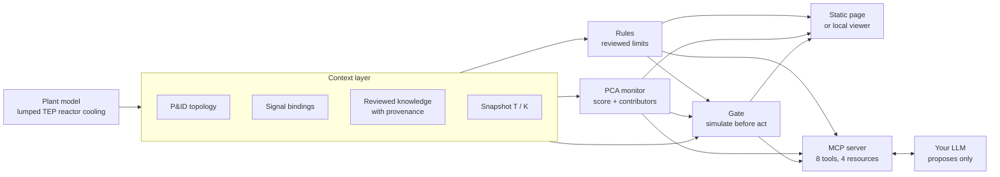

# Plant Context Lab

A context layer for an industrial plant, shown on the Tennessee Eastman process: an LLM can read the plant and propose a control move, and deterministic rules, a PCA monitor and a simulate-before-act gate decide whether that move is allowed.

**Live demo:** [English](https://shaun0457.github.io/plant-context-lab/?lang=en) · [繁體中文](https://shaun0457.github.io/plant-context-lab/)

The page defaults to Traditional Chinese; English is one click away (the EN toggle in the header, or `?lang=en` as in the link above), and the page remembers your choice.

> **Simulation only.** Illustrative model, education only, not for real plant operation. See [What is real and what is simulated](#what-is-real-and-what-is-simulated).

## What you are looking at

- **A context layer, not a dashboard.** P&ID topology (17 units, 18 streams), 53 signal bindings and reviewed engineering knowledge (limits, SOP excerpts, rejected claims) with provenance, all in one model.
- **Live signals pinned to a snapshot.** Every statement on the page cites signal ids, rule ids, knowledge refs and a snapshot id such as `snap@T5.20h/K520` (event horizon T, ingest cutoff K), so it can be reproduced.
- **Three safety layers.** Rules built only from reviewed limits (NORMAL / ATTENTION / ALARM / TRIP), a PCA anomaly monitor that reports a score and contributing variables but never a fault label, and a simulate-before-act gate.
- **The LLM only proposes; the gate decides.** A proposal runs 30 simulated minutes ahead on a branch copy. Only an ACCEPT changes the plant, and disturbance injection is never an agent tool.

## Try it in 30 seconds

1. **Inject the IDV(4) disturbance** (a step in reactor cooling-water inlet temperature) with *Inject disturbance* in Live trends.
2. **Watch the rules, the PCA score and the cooling loop react.** The controller opens `XMV(10)` to hold reactor temperature, the PCA score rises, the rules stay NORMAL.
3. **Propose an `XMV(10)` target and press *Dry run*.** The gate returns ACCEPT or REJECT with machine-readable reasons, and the evaluation goes to the gate log.

Or press **Guided run** at the top of the page: it injects the disturbance, waits for the response, then dry-runs one proposal the gate rejects and one it accepts. Dry runs never change the plant, and *Stop* cancels at any point.

## Connect your own LLM (MCP)

One local Node process (Node.js 22.18 or later) holds one engine and exposes it twice: as an **MCP server over stdio**, and as a **viewer at `http://127.0.0.1:8787/`** that shows the same engine live, so you can watch what your LLM does. Pin a commit so you know what you run; `ef6f14f` below is an example, use the latest commit of `main`.

**Claude Desktop** (`claude_desktop_config.json`, then restart):

```json
{
  "mcpServers": {
    "plant-context-lab": {
      "command": "npx",
      "args": ["-y", "github:shaun0457/plant-context-lab#ef6f14f", "--scenario", "idv4-step5"]
    }
  }
}
```

On Windows, if `npx` is not found, use `"command": "cmd"` with `"args": ["/c", "npx", "-y", "github:shaun0457/plant-context-lab#ef6f14f"]`.

**Claude Code:**

```bash
claude mcp add plant-context-lab -- npx -y github:shaun0457/plant-context-lab#ef6f14f
```

**Any other MCP client (stdio):** command `npx`, args `-y github:shaun0457/plant-context-lab#ef6f14f`. From a clone: `npm install`, then command `node`, args `dist/server.js`. Streamable HTTP is optional: start with `--http-mcp` and connect to `http://127.0.0.1:8787/mcp`.

Then open `http://127.0.0.1:8787/` to watch, and ask for example:

- *"Use the operator-assistant prompt. What is happening in the plant right now?"*
- *"Is any rule close to a limit? Cite the rule ids and the snapshot id."*
- *"Which variables drive the PCA score, and what could explain that?"*
- *"Should I adjust XMV(10)? Simulate it first, then propose it and report the gate's verdict."*
- *"If the reactor cooling-water inlet is disturbed, where could the effect travel?"*

Options (scenarios are human-only; no agent tool can change them):

```text
--scenario normal | idv4-step5 | idv4-step10   start with an IDV(4) step already injected
--port 8787          viewer port on 127.0.0.1 (tries the next 9 if busy)
--tick-ms 1000       real ms per tick; 1 tick = 0.6 simulated min
--seed <n>           noise seed
--no-web             MCP only, no viewer
--http-mcp           also serve MCP over Streamable HTTP at /mcp
--stdio              force stdio when stdin is a terminal
```

Running `npm start` in a terminal starts only the viewer; your MCP client launches its own copy with stdio attached.

### What the server exposes

8 tools, 4 resources, 1 prompt. Every result carries a snapshot id and refs.

| Tool | Behaviour |
|---|---|
| `get_plant_overview` | Topology counts, modelled signals, loop mode, safety summary |
| `get_signals(ids, window_minutes)` | History; at most 8 ids, 60 points each, 288 min window |
| `get_safety_state` | Rule states with rule ids and sources; PCA T², SPE, thresholds, contributors |
| `get_topology_impact(node_id, max_hops)` | Downstream reachability, at most 6 hops. Reachability is not causation |
| `get_engineering_context(node_id)` | Bound signals, reviewed limits, SOP excerpts, knowledge refs |
| `simulate_adjustment(xmv, target, minutes)` | Branch copy with and without the change; never mutates; up to 120 min |
| `propose_adjustment(xmv, target, rationale)` | Runs the gate, applies only on ACCEPT; returns verdict, reasons, snapshot id |
| `get_gate_log` | Recent gate evaluations |

Resources: `manual://operating-manual`, `rules://limits`, `docs://architecture`, `docs://system-prompt`. Prompt: `operator-assistant`.

**By design there is no tool to inject a disturbance, reset the plant or return the loop to AUTO**, and results never reveal the active scenario. The human controls scenarios on the page or with command-line flags.

Security: the viewer and `/mcp` listen on 127.0.0.1 only, reject foreign Host headers and cross-site requests, and page controls need a per-process token. Give the LLM the MCP tools only, not a shell or fetch tool aimed at the viewer port.

Without MCP: paste [`docs/system-prompt.md`](docs/system-prompt.md) as the system prompt and [`docs/operating-manual.md`](docs/operating-manual.md) plus [`docs/rules.md`](docs/rules.md) as context into any chat model, with numbers read off the page.

## Architecture



All of it is one engine in plain TypeScript with no DOM access (`src/engine/`). The static page inlines it; the local server imports it.

### Safety layers in detail

**Rules.** Only limits approved in the reviewed knowledge are used; both are also published by Downs & Vogel (1993).

| Rule id | Signal | Condition | State |
|---|---|---|---|
| `RL-XMEAS9-ATT` | `XMEAS(9)` reactor temperature | ≥ 142.6 degC | ATTENTION (demo convention: last 25 % of headroom) |
| `RL-XMEAS9-NU` | `XMEAS(9)` | > 150 degC | ALARM |
| `RL-XMEAS9-SD` | `XMEAS(9)` | ≥ 175 degC | TRIP |
| `RL-XMEAS7-ATT` | `XMEAS(7)` reactor pressure | ≥ 2847.5 kPa gauge | ATTENTION (demo convention) |
| `RL-XMEAS7-NU` | `XMEAS(7)` | > 2895 kPa gauge | ALARM |
| `RL-XMEAS7-SD` | `XMEAS(7)` | ≥ 3000 kPa gauge | TRIP |

Every other signal is reported as "no reviewed limit", never guessed. The rejected "145 degC" claim is never used. TRIP is reported, not executed. Full sources: [`docs/rules.md`](docs/rules.md).

**PCA monitor.** Six modelled signals (`XMEAS(7)`, `XMEAS(9)`, `XMEAS(11)`, `XMEAS(13)`, `XMEAS(21)`, `XMV(10)`), 5-sample moving mean, 2 components, empirical 99 % limits (T² ≈ 11.74, SPE ≈ 0.461), trained offline on simulated normal operation with small operator moves (`npm run train:pca`). It outputs T², SPE, a score and the top contributors. There is no fault classifier.

**Gate.** `evaluateAdjustment()` returns ACCEPT or REJECT with reason codes, and logs every evaluation. It rejects an unknown or unmodelled XMV (only `XMV(10)` is simulated), a target outside 0–100 %, a step over 10 %-points, more than 15 %-points within 10 simulated minutes, any proposal during TRIP, and any change whose 30-minute branch simulation reaches ALARM / TRIP, eats more than 5 % of a ruled signal's headroom, or clearly worsens SPE. An ACCEPT puts the loop in MANUAL at the target; returning to AUTO is a human button. The gate checks a safety envelope, not whether a move is wise: under IDV(4) the controller has usually compensated already, so the right advice is often "no adjustment".

## What is real and what is simulated

- **Simulated:** the trends come from a simplified lumped model of the reactor-cooling subsystem that runs in your browser (or on your machine in connected mode). It is not output from the TEP simulator, and values are illustrative.
- **Real data, illustrative use:** the topology and signal bindings come from a human-verified TEP process graph; the flowsheet layout is hand-drawn after the classic TEP flowsheet. Rule limits come from reviewed knowledge; the ATTENTION band and the headroom check are labelled demo conventions. The PCA thresholds describe this toy model only.
- **Education only.** The rules, the PCA monitor, the gate and any LLM advice built on them must not be used for real plant operation.
- The static page is one self-contained HTML file with no network requests.

References:

- J. J. Downs and E. F. Vogel, "A plant-wide industrial process control problem," *Computers & Chemical Engineering*, 17(3), 1993.
- A. Bathelt, N. L. Ricker and M. Jelali, "Revision of the Tennessee Eastman process model," *IFAC-PapersOnLine*, 48(8), 2015.

## Engineering depth

This demo is the lightweight showcase. The full implementation of the context layer, with its contracts, specs and tests, lives in the public repository [tep-agent-lab](https://github.com/shaun0457/tep-agent-lab): an industrial context layer with a domain-neutral core and a Tennessee Eastman process pack, snapshot-bound telemetry, and a human-reviewed engineering-knowledge path. Live plant streaming through canonical telemetry and knowledge extraction with human review are implemented there; plant context composition and the UI read of pinned snapshots are in progress.

## Development

```bash
npm install
npm run build     # typecheck, inline engine + UI strings into index.html, bundle dist/server.js, regenerate docs/rules.md
npm test          # node:test: engine, rules, PCA, gate, MCP handlers, viewer server, i18n, build freshness
npm run train:pca # regenerate src/engine/pca-model.json (then npm run build)
```

`index.html` (served by GitHub Pages) and `dist/` are build outputs and are committed, so `npx github:shaun0457/plant-context-lab` needs no build toolchain. A test fails if either is stale.

```text
src/engine/   plant model, rules, PCA, gate, topology, knowledge, simulation (shared)
src/page/     page UI strings, English and Traditional Chinese
src/server/   web viewer (127.0.0.1), MCP tools/resources/prompt, CLI entry
web/          page template
scripts/      build and PCA training
docs/         system prompt, operating manual, architecture, generated rules
test/         node:test suites
```

## 繁體中文摘要

以 Tennessee Eastman 製程（TEP）示範工業工廠的 context layer：P&ID 拓撲、訊號綁定與已審核的工程知識都釘在確切的 snapshot 上；規則（只用已審核限值）、PCA 異常監測（只輸出分數與貢獻變數，不輸出故障標籤）與「先模擬再執行」的 gate 決定提議的調整能不能執行。網頁預設繁體中文，右上角可切換英文（或加 `?lang=en`），頁面會記住你的選擇。

- 30 秒上手：注入 IDV(4) 擾動 → 觀察規則、PCA 與冷卻迴路的反應 → 對 XMV(10) 試算，看 gate 接受或拒絕及原因；也可以按「導覽執行」自動跑一遍。
- 想讓自己的 LLM 參與：`npx -y github:shaun0457/plant-context-lab` 啟動本機 MCP server，再開 `127.0.0.1:8787` 觀看。LLM 只能提議，由 gate 決定；擾動注入只能由人操作。
- **全部都是模擬，僅供教學，不可用於實際工廠操作。**
